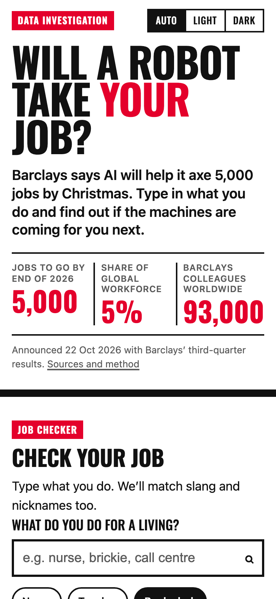

# Will a robot take your job?

A mobile-first data interactive built around the Barclays story of 22 October 2026: around 5,000 jobs,
about 5% of the bank's global workforce, to go by the end of the year, with the chief executive crediting
technology and AI. The reader types in their own job and gets a score, a verdict, a rank against every
other job in Britain, and a sense of what the robots can already do.

**Live:** https://robot-job-check.vercel.app
**Stack:** Next.js 16 (App Router, TypeScript), CSS Modules, D3 as React components, pandas pipeline, Vercel, Upstash Redis for the poll.



## The story in one paragraph

Barclays is cutting roughly 5,000 roles and 60% of them are in "support functions, including developers".
That is an unusual admission: the jobs AI reaches first are not on the shop floor but at the desk. The
interactive makes that personal. You check your own job, you see bank clerks sitting far to the right of
bricklayers on a chart of every occupation in the country, and you vote on whether you would trust a robot
with your money. Every number on the page traces back to a named source in the footer and in
[`data/README.md`](data/README.md).

## Page, top to bottom

| # | Section | What it does |
|---|---|---|
| 1 | Hero | Headline, the three Barclays numbers (5,000 / 5% / c.93,000), one-line standfirst. Not a 100vh hero. |
| 2 | Job checker | Fuzzy search over 408 occupations and 5,256 aliases ("brickie" finds Bricklayers). Popular chips. Preloaded with bank clerks so it is never empty. Result: traffic-light gauge, verdict, rank, "more exposed than X% of jobs", headcount, task breakdown, copy-to-clipboard share line. |
| 3 | What Barclays said | Seven-stop timeline from the 2023 cuts to the 2027 savings target, each stop sourced. |
| 4 | Which bank jobs | Twenty bank roles ranked by exposure, horizontal bars, reader's job highlighted. |
| 5 | League table | Most at risk vs safest ten, toggle, reader's job highlighted or spliced in at its true position. |
| 6 | Every job in Britain | Force-layout beeswarm: x = exposure, area = headcount, reader's dot pulsing and labelled. Tap a dot to make it your job. |
| 7 | What the robots can already do | Count-up to 15%, the Eloundou et al. share of tasks an LLM alone could do significantly faster, with the 47 to 56% with-tooling figure and the Government's 70% of UK workers figure. |
| 8 | Poll | "Would you trust a robot with your money?" Real counts in Redis, one vote per reader per day. |
| 9 | Methodology | What the score is and is not, how verdicts are drawn, code mapping, task derivation, every Barclays fact with its quote and URL, every dataset with licence. |

## The data

Full detail, including why each source was chosen over the alternatives in the brief, is in
[`data/README.md`](data/README.md). Short version:

- **Who does what:** ONS Annual Population Survey, 4-digit SOC 2020, April 2025 to March 2026. 33.3 million
  people in work across 412 unit groups.
- **How exposed each job is:** Felten, Raj and Seamans' AI Occupational Exposure index, as mapped to UK
  SOC 2010 by the Department for Education (Nov 2023). Carried to SOC 2020 with the ONS relationship
  tables, weighting each old code by how many of its workers landed in each new one. 408 of 412 groups
  scored; the four gaps (elected officials, armed forces officers and other ranks, waste managers) are
  0.4% of employment and are listed on the page.
- **Why not the ONS automation probability** that the brief put first: England only, 2017 data, pre-LLM
  method, cleaners and drivers at the top. It is the wrong lens for a story about desk jobs, so it is kept
  as a secondary column in the JSON and discussed in the methodology, not used for the verdict.
- **Tasks and aliases:** ONS SOC 2020 Volume 1 (tasks, related job titles) and Volume 2 coding index
  (32,670 job titles). Per-task exposure is **derived** by a documented keyword rule and labelled
  "Estimated" everywhere it appears, because no published source scores UK tasks.
- **Score and verdicts:** score is the AIOE min-max rescaled to 0 to 100. Verdict bands are
  employment-weighted tertiles (each band holds a third of UK workers), published in the JSON and read by
  the front end rather than hard-coded.
- **Barclays:** every figure in `public/data/barclays-facts.json` carries the sentence it came from and the URL
  (CNBC, City A.M., the Q3 2026 earnings call transcript, the 2025 Annual Report, Euronews, LBC).

Regenerate everything with:

```bash
python3 -m venv data/.venv && data/.venv/bin/pip install -r data/requirements.txt
npm run data
```

## Design decisions

- **Tabloid energy without the masthead.** Oswald for display, system font for body, one red, black
  rules, numbers set huge. No logo, no imitation of any title's branding.
- **Verdicts are three words long** and each comes with a non-colour mark (✓ ! ✕) so the gauge, bars and
  beeswarm never rely on colour alone.
- **The reader's job is the thread.** One piece of state in `Story.tsx` drives the result card, the bank
  bars, the league table and the beeswarm, so scrolling keeps paying off after the search.
- **Honest about estimates.** Per-task scores are labelled "Estimated" with a one-line explanation under
  the chart, and the methodology says plainly that exposure is not job loss.
- **Charts are React components that use D3 for maths only.** `d3-shape` draws the gauge arcs,
  `d3-scale` sizes the bars, `d3-force` lays out the swarm; React owns the DOM. No pasted examples, no
  `select()`.
- **Light and dark from CSS tokens**, following the OS with a three-way override stored in
  `localStorage` and applied before first paint.
- **Performance budget.** The page prerenders to static HTML. The 467 KB occupations file (about 90 KB
  over the wire) loads when the browser is idle; the search index builds on first focus; the beeswarm and
  `d3-force` load only when the reader scrolls near them. Lighthouse mobile (local, simulated throttling):
  performance 99, accessibility 100, best practices 96, SEO 100.
- **Accessibility.** WAI-ARIA combobox for search, `aria-live` on the result, `aria-pressed` toggles,
  visible focus rings, `prefers-reduced-motion` disables the needle sweep, bar sweeps, pulse and count-up.
  The beeswarm has a text summary and a "read as a list" fallback. Works at 375px with no horizontal
  scroll (asserted in the Playwright suite).

## Running it

```bash
npm install
npm run dev            # http://localhost:3000
npm test               # Jest: search matcher, verdict logic, ranking (24 tests)
npm run build && npm run test:e2e   # Playwright mobile smoke test (searches "nurse", checks the verdict)
npm run lint && npm run typecheck
```

The poll needs two environment variables, provisioned by the Upstash integration on Vercel
(`UPSTASH_REDIS_REST_URL`, `UPSTASH_REDIS_REST_TOKEN`, or the `KV_REST_API_*` pair). Without them the
poll shows "having a lie down" and everything else works.

## Embedding in a CMS

The page is static HTML plus one route handler, so the simplest embed is an iframe of the Vercel URL.
Because the API is the only server dependency, a pure static export is one step away: point
`NEXT_PUBLIC_POLL_API` at the deployed origin, remove `src/app/api`, add `output: "export"` and the
`out/` folder can be dropped into any host.

## Repository layout

```
data/            Python pipeline, curated inputs, data README
public/data/     occupations.json, bank-roles.json, barclays-facts.json (generated)
src/lib/         search, verdict, ranking, formatting + Jest tests
src/components/  one component per section and chart, CSS Modules alongside
src/app/         layout, page, globals.css, api/poll route handler
tests/e2e/       Playwright smoke test
```

## Caveats I would raise in the newsroom

- Exposure measures overlap between a job's abilities and AI capability. It is not a forecast of cuts.
- The DfE scores are from 2023 on 2021 ability data; the field moves faster than official statistics.
- Split SOC groups inherit one parent score (the seven nursing groups share two).
- Per-task numbers are an editorial derivation, clearly marked; they are there to make the breakdown
  legible, not to be quoted.
